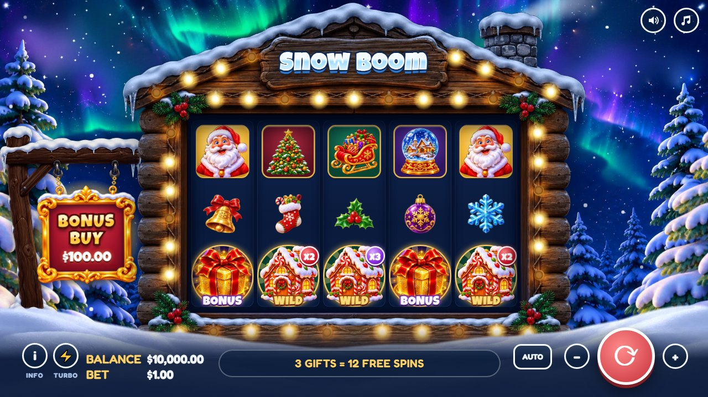
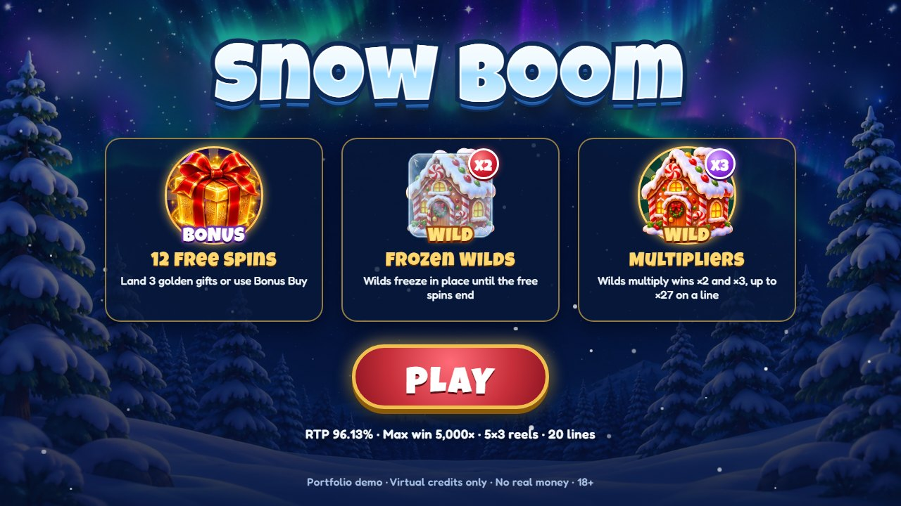
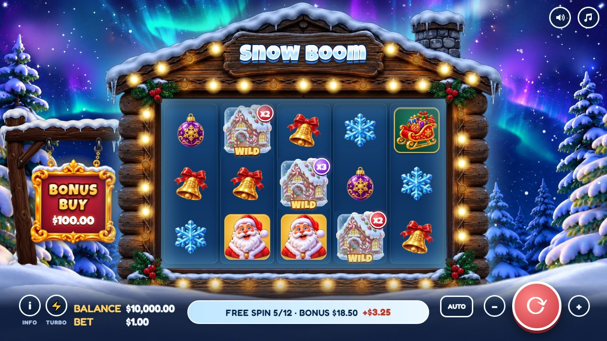
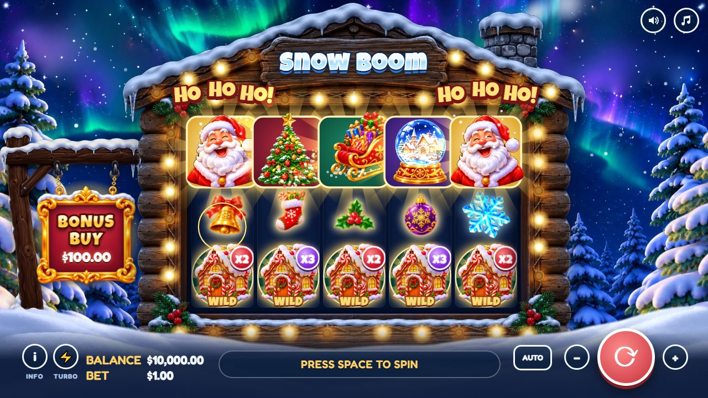

# Snow Boom

Новогодний онлайн-слот 5×3 с собственной математической моделью, Frozen Wild и покупкой бонуса. Работает в браузере.

> **Учебный и портфолио-проект.** Только виртуальные кредиты, реальных денег нет. 18+.
>
> **Исходный код и математическая модель закрыты.** В этом репозитории описание проекта, скриншоты и архитектура. Игру я показываю лично.

*English summary is at the end of this page.*

## Описание проекта

Цель проекта — пройти путь разработки слота целиком: от расчёта математики до готовой игры с графикой, анимацией и звуком.

**Как устроена игра**

- **Поле:** 5 барабанов, 3 ряда, 20 фиксированных линий, выплаты слева направо.
- **Wild (пряничный домик):** заменяет символы и умножает выигрыш линии на ×2 или ×3. Несколько Wild на линии перемножаются, до ×27.
- **Scatter (золотой подарок):** три подарка запускают 12 фриспинов.
- **Frozen Wild:** во фриспинах каждый выпавший Wild замерзает и остаётся на месте до конца бонуса.
- **Bonus Buy:** бонус можно купить сразу.
- **Максимальный выигрыш:** 5 000× ставки.

**Что есть в игре, кроме механики**

- свои анимации у символов, у дорогих символов — из отдельных слоёв изображения;
- интрига на последнем барабане, когда до бонуса не хватает одного подарка;
- досрочная остановка спина, которая не влияет на результат;
- экран крупного выигрыша с бегущей суммой и уровнями BIG WIN, MEGA WIN и SNOW BOOM!;
- звуки и две мелодии, созданные кодом через Web Audio, и голос Санты (готовая запись);
- адаптация под телефон и турбо-режим.

## Скриншоты

| Заставка | Фриспины с Frozen Wild |
|---|---|
|  |  |

| Крупный выигрыш | Анимации символов |
|---|---|
|  |  |

## Итоговые показатели

| Показатель | Цель | Результат |
|---|---|---|
| RTP общий | 96% | **96.13%** |
| RTP основной игры | 66% | **66.00%** |
| RTP фриспинов | 30% | **30.13%** |
| Hit rate | 30% | **30.22%** |
| Win > bet | 15% | **15.01%** |
| RTP покупки бонуса | 96% | **96.42%** |

RTP основной игры посчитан точно, полным перебором комбинаций, а бонус — методом Монте-Карло. Движок игры независимо сверяется с математической моделью: встроенный симулятор прогоняет десятки миллионов спинов прямо в браузере.

## Технологический стек

| Часть | Технологии |
|---|---|
| Игра | HTML5, CSS3, JavaScript (ES2020), без фреймворков |
| Графика и анимация | Canvas 2D (частицы, анимации символов), CSS-анимации, Web Animations API (барабаны) |
| Звук | Web Audio API: эффекты и музыка синтезируются кодом, голос Санты — готовая запись |
| Математика | Python 3, NumPy |
| Хранение настроек | localStorage браузера |
| Шрифты | Google Fonts: Fredoka, Luckiest Guy |
| Контроль версий | Git, GitHub |

Архитектура описана в [docs/архитектура.md](docs/архитектура.md).

## Ограничения

Это демонстрация, а не продукт для реальных денег. Результат спина считается в браузере, поэтому его можно подменить через инструменты разработчика. В настоящем казино результат считает сертифицированный сервер, а браузер только показывает его.

---

## English summary

**Snow Boom** is a Christmas-themed 5×3 video slot that runs in the browser. It is a study and portfolio project: virtual credits only, no real money, 18+. The source code and math model are private; this repository holds the description, screenshots and architecture.

- **Features:** 20 paylines, multiplying Wilds up to ×27, 12 free spins with sticky Frozen Wilds, Bonus Buy and a 5,000× max win.
- **Results:** 96.13% RTP (66.00% base game, 30.13% free spins), 30.22% hit rate, 96.42% Bonus Buy RTP.
- **Stack:** vanilla JavaScript, Canvas 2D, Web Animations API, Web Audio API; Python with NumPy for the math model.
- **Limitation:** results are generated in the browser. A real-money game would calculate them on a certified server.
