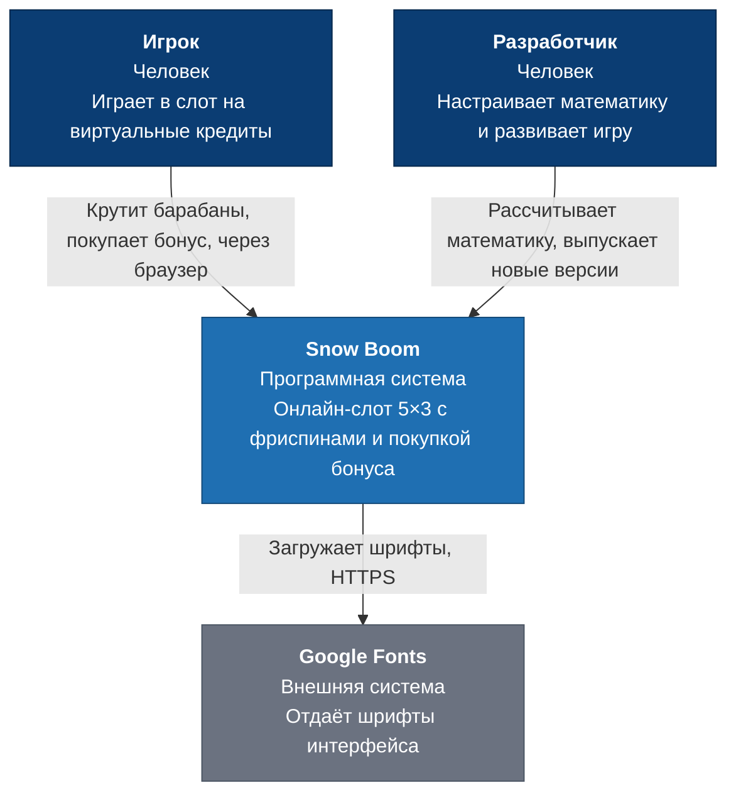
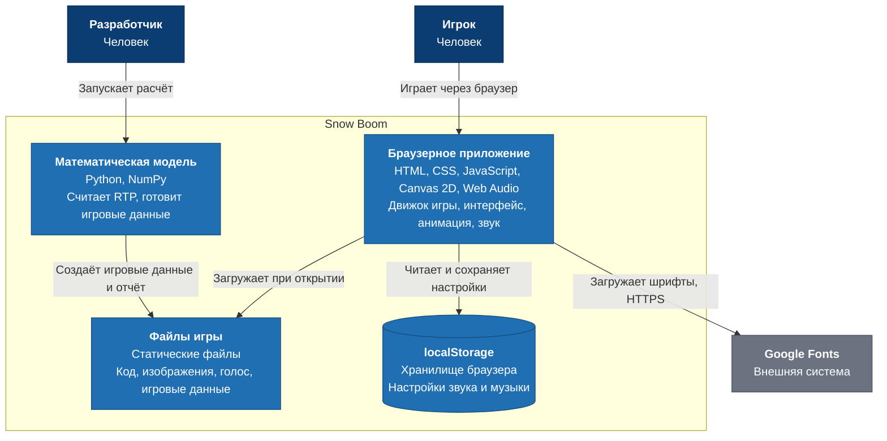

# Архитектура Snow Boom

Описание по модели C4: уровень C1 показывает систему и её окружение, уровень C2 — из каких частей она состоит.

Главная особенность системы: **у неё нет сервера с игровой логикой**. Вся игра работает в браузере игрока, а математическая модель запускается только у разработчика и заранее готовит данные для игры.

## C1. Контекст системы

| Участник | Роль | Как взаимодействует с системой |
|---|---|---|
| Игрок | Пользователь | Открывает игру в браузере на компьютере или телефоне |
| Разработчик | Создатель игры | Пересчитывает математику и выпускает новую версию |
| Google Fonts | Внешняя система | Отдаёт шрифты. Если сервис недоступен, браузер подставит другие шрифты, игра продолжит работать |

Платёжных систем, учётных записей и внешнего сервера результатов нет: это демонстрация на виртуальных кредитах.

## C2. Контейнеры

| Контейнер | Технологии | За что отвечает |
|---|---|---|
| Браузерное приложение | HTML, CSS, JavaScript | Случайные остановки барабанов, расчёт выигрыша, баланс, интерфейс, анимация, звук |
| Файлы игры | Статические файлы | Доставка игры в браузер. Отдельный сервер с логикой не нужен |
| localStorage | Хранилище браузера | Запоминает, включены ли звук и музыка. Баланс не хранит: после перезагрузки он снова равен $10,000 |
| Математическая модель | Python 3, NumPy | Считает RTP, hit rate и частоту бонуса, создаёт данные для игры и отчёт |

Исходный код и математическая модель хранятся закрыто, поэтому в этом репозитории их нет.

## Основные решения

- **Математика отделена от игры.** Модель на Python считает игровые данные, а игра читает их из готового файла. Значит, настройку математики можно менять, не трогая код игры.
- **Движок проверяется независимо.** Игра на JavaScript и модель на Python считают выигрыши отдельно, поэтому встроенный симулятор сравнивает результаты двух реализаций.
- **Результат выбирается до анимации.** Сначала определяются остановки барабанов, затем идёт показ. Поэтому анимация, интрига и досрочная остановка не влияют на шансы.
- **Нет сервера с игровой логикой.** Это упрощает запуск, но результат можно подменить в браузере. Для демо на виртуальных кредитах это допустимо. В игре на реальные деньги результат должен считать сертифицированный сервер.
